# Local AI from a USB drive: a tested setup of Portable Local Studio

This repo shows how to run AI models from one USB drive on a Windows PC. You get a chat assistant, an image maker, speech-to-text, text-to-speech and, new in this repo, short text-to-video clips. All of it runs on your own PC, without an account. After setup, chat runs without internet (see [Offline](#9-use-it-offline)).

The app is **Portable Local Studio** by Tech Jarves. This repo contains a tested setup manual, 18 screenshots, real output files and disk measurements. It also contains an independent copy of the app in [`studio/`](studio/) with one new feature: a **Video** tab ([section 7.6](#76-make-a-short-video-new-video-tab)). The repo does not contain models.

**Read the full manual (live page):** <https://az9713.github.io/local-studio-usb-ai-demo/local-studio-windows-setup.html>

> [!NOTE]
> **Upstream project and credit.** The app is [github.com/techjarves/Portable-Local-Studio](https://github.com/techjarves/Portable-Local-Studio), MIT License, Copyright (c) 2026 Tech Jarves. The app's code still names the old repo, `github.com/techjarves/Uncensored-AI-Studio`. That address redirects to Portable-Local-Studio. The creator's setup video is <https://youtu.be/yeFvP3SWMak>. This repo is not part of the upstream project. All credit for the app goes to its creator.

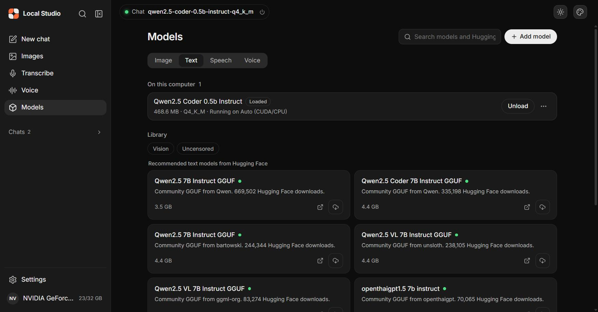

---

## Contents

1. [What you need](#1-what-you-need)
2. [The models we used](#2-the-models-we-used)
3. [How much of the 128 GB drive it uses](#3-how-much-of-the-128-gb-drive-it-uses)
4. [Can text, image and audio models run at the same time?](#4-can-text-image-and-audio-models-run-at-the-same-time)
5. [Set it up on a USB drive (step by step)](#5-set-it-up-on-a-usb-drive-step-by-step)
6. [Your first chat](#6-your-first-chat)
7. [Examples: images, speech, voice, a voice loop and video](#7-examples-images-speech-voice-and-a-voice-loop)
8. [Keep every file on the drive](#8-keep-every-file-on-the-drive)
9. [Use it offline](#9-use-it-offline)
10. [Stop the app and remove the drive](#10-stop-the-app-and-remove-the-drive)
11. [Problems and fixes](#11-problems-and-fixes)
12. [What we did not test](#12-what-we-did-not-test)
13. [Files in this repo](#13-files-in-this-repo)

---

## 1. What you need

| Item | Requirement |
|---|---|
| PC | 64-bit Windows 10 or Windows 11 on an x64 processor. |
| USB drive | 128 GB was our target. The whole setup in this repo used 8.10 GB, so a 32 GB drive also holds it. Use USB 3.0 or faster. |
| Free space | At least 15 GB on the drive. |
| Internet | Necessary for the first setup (16.8 minutes on our laptop) and for each model download. |
| Graphics card (GPU) | Not necessary. An NVIDIA GPU makes chat and images faster. AMD and Intel GPUs use Vulkan. Without a GPU, the app uses the processor (CPU). |
| Browser | Any modern browser. The app is a local web page. |

**Our test PC:** HP Victus laptop, Intel i5-12450H, 31.7 GB RAM, NVIDIA RTX 3050 Laptop GPU with 4 GB of video memory (VRAM), Windows 11 Home. Tested 31 Oct – 1 Nov 2026.

> [!IMPORTANT]
> **How we simulated the USB drive.** Our laptop had no USB drive connected. We copied the app to `C:\AI\usb128` and ran `subst U: C:\AI\usb128`. Windows then showed that folder as drive `U:`, and the app ran only from `U:\`. We did not test a different drive letter, USB speed or the exFAT file system. The 128 GB limit was audit only: we measured the folder, but nothing stopped it from growing past 128 GB.

---

## 2. The models we used

We used six models: two for chat, one for images, one for speech-to-text, one for text-to-speech and one motion module for video.

| Job | Model | File on the drive | Size (bytes) | Runs on | Speed on our laptop |
|---|---|---|---:|---|---|
| Chat (small, first test) | Qwen2.5 Coder 0.5B Instruct, Q4_K_M | `app\llm-models\qwen2.5-coder-0.5b-instruct-q4_k_m.gguf` | 491,400,064 | GPU (CUDA) | 21 tokens in 419 ms |
| Chat (main) | Qwen2.5 1.5B Instruct, Q4_K_M | `app\llm-models\qwen2.5-1.5b-instruct-q4_k_m.gguf` | 1,117,320,736 | GPU (CUDA) | 51 tokens in 1.07 s |
| Images | DreamShaper 8 (Stable Diffusion 1.5) | `app\models\DreamShaper_8_pruned.safetensors` | 2,132,625,894 | GPU (CUDA), 2,035 MB VRAM | 512×512, 20 steps: 34.3 s |
| Speech to text | Whisper Base English | `app\speech-models\ggml-base.en.bin` | 147,964,211 | CPU, 8 threads | 14.4 s memo in 9.2 s; 8.0 s question in 2.0 s |
| Text to speech | Kokoro 82M ONNX Q8 | `app\tts-runtime\node_modules\@huggingface\transformers\.cache\onnx-community\Kokoro-82M-v1.0-ONNX\onnx\model_quantized.onnx` (+ a 424-byte manifest in `app\tts-models`) | 92,361,116 | CPU | 14.4 s clip ready about 14 s after the click |
| Video (new tab) | AnimateDiff v3 motion module, used with DreamShaper 8 | `app\video-models\mm_sd15_v3.safetensors` | 836,618,008 | GPU (CUDA), capped at 2 GiB | 384×384, 8 frames, 20 steps: 152.6 s (GPU free) |
| **Total** | | | **4,818,290,453** | | |

The engines that run the models come with the app: llama.cpp (chat), stable-diffusion.cpp (images), whisper.cpp (speech-to-text) and kokoro-js on Transformers.js (text-to-speech).

**Why these models?** They are small enough for a 4 GB GPU and they download in minutes. The app's library also offers larger models, for example Qwen2.5 7B (3.5–4.4 GB) and two SDXL image models (6.9 GB and 7.1 GB). We did not test those.

---

## 3. How much of the 128 GB drive it uses

**With video added: 8,933,067,683 bytes (8.93 GB, 8.32 GiB) in 11,027 files** (measured 1 Nov 2026, 14:17). Video added 836,992,205 bytes: the 836,618,008-byte motion module, 3 test clips and the new code. That is about 7.0 % of a 128 GB drive, so about 110.9 GiB stays free.

The numbers below are from before video: **8,096,075,478 bytes (8.10 GB, 7.54 GiB) in 11,021 files.** We measured it after all tests, with all five models and all test outputs on the drive. A 128 GB drive holds about 119.2 GiB, so the studio used about 6.3 % of it. About 111.7 GiB stayed free.

Before we added the image, speech and voice models, the app with the two chat models used 5,720,534,998 bytes (5.72 GB). The app alone, without models, is about 4.1 GB.

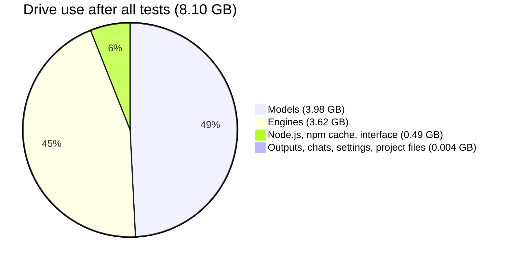

| Folder | What it holds | Bytes | Share |
|---|---|---:|---:|
| `app\models` | Image model (DreamShaper 8) | 2,132,625,894 | 26.3 % |
| `app\llm-backend` | Chat engines (llama.cpp: CUDA 1.19 GB, SYCL 0.46 GB, Vulkan 0.09 GB, CPU 0.05 GB) | 1,801,611,060 | 22.3 % |
| `app\llm-models` | Chat models (2 × `.gguf`) | 1,608,720,800 | 19.9 % |
| `app\backend` | Image engines (stable-diffusion.cpp: CUDA 1.20 GB, Vulkan 0.11 GB, CPU 0.06 GB) | 1,377,717,831 | 17.0 % |
| `app\tts-runtime` | Voice runtime, including the 92 MB Kokoro model | 517,052,337 | 6.4 % |
| `app\tools` | Portable Node.js (96 MB) and the npm cache (214 MB) | 309,832,151 | 3.8 % |
| `app\frontend` | Interface source and packages | 172,387,299 | 2.1 % |
| `app\speech-models` | Whisper Base English | 147,964,211 | 1.8 % |
| `app\speech-backend` | Speech engine (whisper.cpp, CPU) | 20,355,072 | 0.3 % |
| `app\dist` | Built interface | 3,860,202 | < 0.1 % |
| `app\tts-outputs`, `app\outputs`, `app\transcriptions`, `app\chat-history`, `app\config`, `app\tts-models` | Your voice clips, images, transcripts, chats and settings | 2,589,820 | < 0.1 % |
| `scripts`, `docs`, `assets`, root files | Project files from the ZIP | 1,358,377 | < 0.1 % |
| **Total** | | **8,096,075,478** | **100 %** |

**Evidence:** [`evidence/storage-measurement.txt`](evidence/storage-measurement.txt) has the raw measurement, the method, the engine variants and the check for files outside the drive.

**What this means for you:** models and engines use 94 % of the space. Your images, clips and chats are small: 2.6 MB for all of our tests. Each larger model that you add uses its download size. For example, one SDXL image model (7.1 GB) and one 7B chat model (4.4 GB) would bring the total to about 19.6 GB.

---

## 4. Can text, image and audio models run at the same time?

**Short answer:** one large model at a time on the GPU (chat **or** image). The speech-to-text and text-to-speech models run on the CPU at the same time as the chat model.

| Combination | Result | Evidence |
|---|---|---|
| Chat model + image model | **No. One at a time.** When you load one, the app asks you to unload the other. | Dialog text: "Only one large model can run at a time". Screenshot below. TESTED |
| Two chat models | **No.** Unload the first model, then load the second one. | Error: "… is already loaded as a Text model. Unload it before loading …" TESTED |
| Chat model + Whisper (speech-to-text) + Kokoro (text-to-speech) | **Yes.** The 1.5B chat model stayed loaded while Whisper and Kokoro worked. | The voice loop in [section 7.4](#74-a-jarvis-voice-loop-all-three-together). TESTED |
| Image model + Whisper or Kokoro | Not tested. | — |
| Video + chat or image model | **No. One at a time.** The Video tab asks "Unload the chat model?" first. | Screenshot in [section 7.6](#76-make-a-short-video-new-video-tab). TESTED |

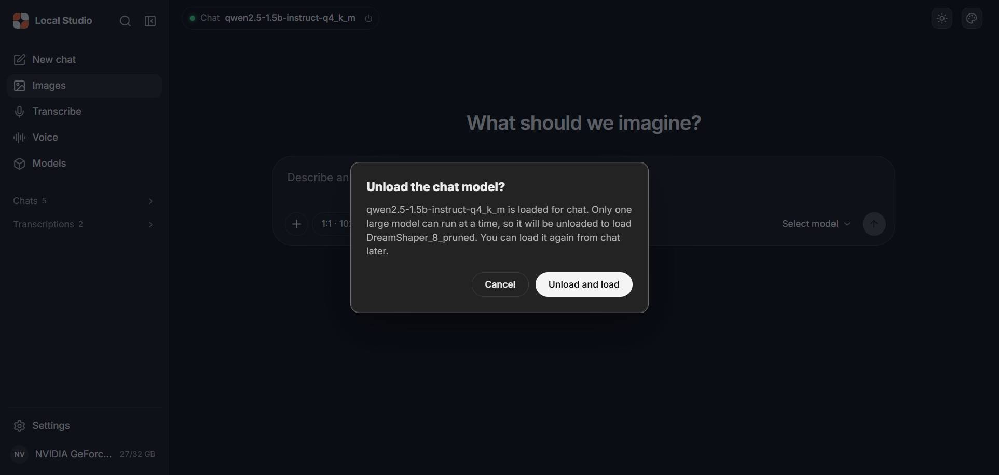

To switch between chat and images, click **Unload and load** in this dialog. The other model unloads, and you can load it again later.

---

## 5. Set it up on a USB drive (step by step)

The live manual has the same steps with more detail: [Steps 3–5](https://az9713.github.io/local-studio-usb-ai-demo/local-studio-windows-setup.html#drive).

### 5.1 Prepare the drive

> [!WARNING]
> Formatting a drive deletes all of its data. Back up the drive first. Check the drive name and capacity, not only its letter.

1. Plug the USB drive into the PC.
2. Format it as **NTFS** if you use it only on Windows. Use **exFAT** if you also use it on a Mac or Linux PC (we did not test exFAT).
3. Do not use FAT32. FAT32 cannot hold a file larger than about 4 GB, and many models are larger.

**Tip:** the manual suggests that you install on the internal disk first, then copy the full folder to the drive. A problem is easier to find on the internal disk.

### 5.2 Download the app

1. Open <https://github.com/techjarves/Portable-Local-Studio>.
2. Click the green **Code** button. Then click **Download ZIP**.
3. Right-click the ZIP file. Click **Extract All**.
4. Extract to the root of the USB drive, for example `E:\`.
5. Open the extracted folder. Make sure that it holds `windows.bat`, `linux.sh`, `mac.sh`, `app` and `scripts`.

> [!CAUTION]
> Do not run `windows.bat` from inside the ZIP. Always extract first. Do not put one project folder inside another.

### 5.3 Run the first-time setup

> [!WARNING]
> `windows.bat` force-closes every program that uses port 8080 or port 10086, at setup and at each launch. Stop other local web or AI tools first.

1. Make sure that the PC is online.
2. Open the project folder on the drive in File Explorer.
3. Click the address bar. Type `cmd` and press **Enter**. A black Command Prompt window opens in that folder.
4. Type this command and press **Enter**. It keeps the setup download cache on the drive, not on drive C:.
   ```bat
   set npm_config_cache=%CD%\app\tools\npm-cache
   ```
5. Type this command and press **Enter**:
   ```bat
   windows.bat
   ```
6. Read the banner. It says **First-Time Setup**. Press any key to continue.
7. Wait. Setup has 8 steps. On our laptop, it took 16.8 minutes. Your network speed sets most of this time.
8. If Windows asks to install the **Microsoft Visual C++ Redistributable (x64)**, check that the publisher is Microsoft. Then click **Yes**.
9. When setup ends, the browser opens at `http://localhost:1420`.

**Your address can be different.** If port 1420 is in use, the app uses a port from 1421 to 1499. Our test ran at `http://localhost:1421`. Use the address in the terminal's **Web UI:** line.

**Next time:** double-click `windows.bat`. Setup does not run again.

---

## 6. Your first chat

### 6.1 Set the KV cache to Q8_0 first

> [!WARNING]
> On a PC with less than 6 GB of VRAM, the app calls your PC "Potato PC" and recommends **KV q4_0**. With Qwen2.5 models, KV q4_0 made the answers nonsense in our test. KV Q8_0 and F16 gave correct answers.

1. In the sidebar, click **Settings**.
2. Click the **Text generation** tab.
3. Under **Performance → Profile**, click **Balanced**.
4. Under **KV cache**, click **Q8_0**.
5. If an "Unsaved text settings" bar appears, save the changes.

| The app's recommendation ("Potato PC … KV q4_0") | The settings that worked (Balanced, GPU layers All, KV Q8_0) |
|---|---|
| 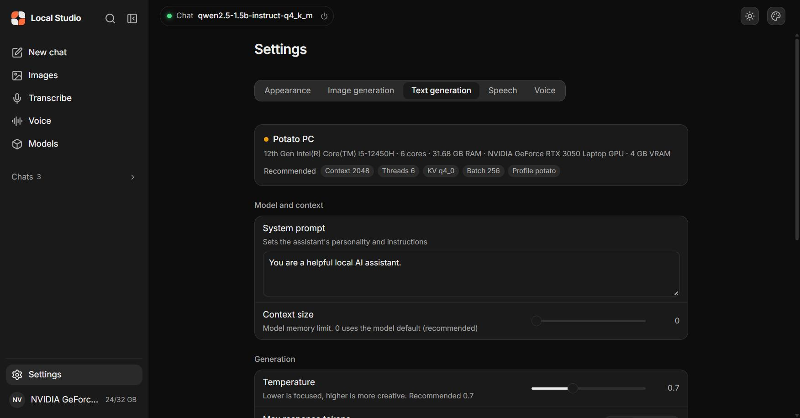 | 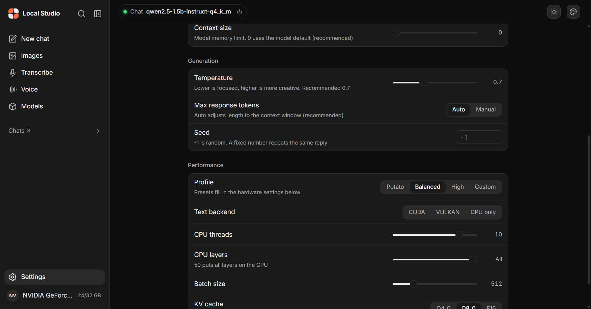 |

### 6.2 Download a chat model

1. In the sidebar, click **Models**. Click the **Text** tab.
2. Click **Add model**. Click **Download from a link**.
3. Paste this link and click **Download**:
   ```
   https://huggingface.co/Qwen/Qwen2.5-1.5B-Instruct-GGUF/resolve/main/qwen2.5-1.5b-instruct-q4_k_m.gguf
   ```
4. Wait until the model shows under **On this computer**.

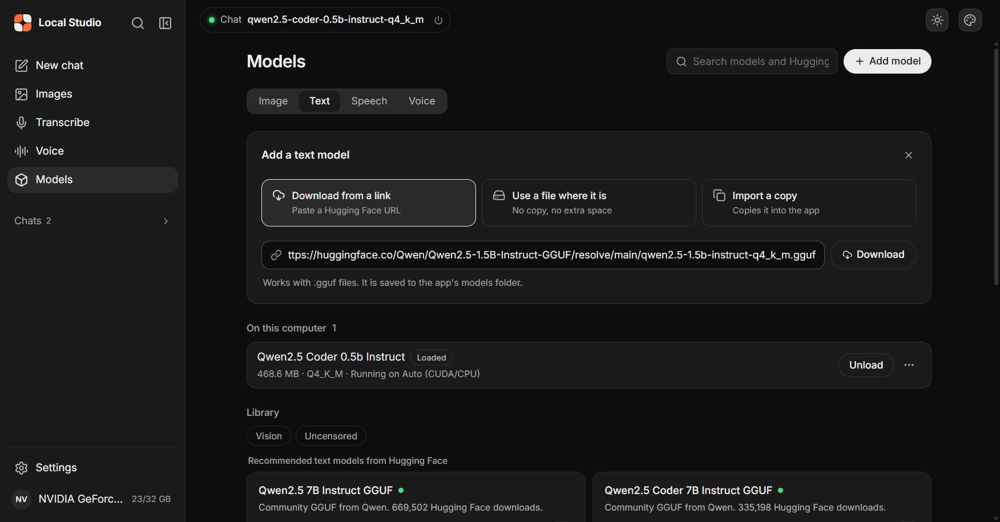

### 6.3 Chat

1. Click **New chat**.
2. Select the model in the selector at the bottom of the chat box.
3. Type a question and press **Enter**.

| Select the model | A correct answer from the 1.5B model (51 tokens, 1.07 s) |
|---|---|
| 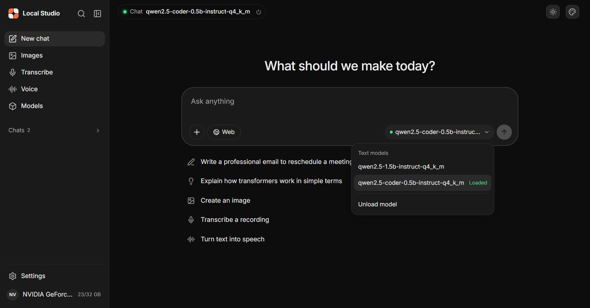 | 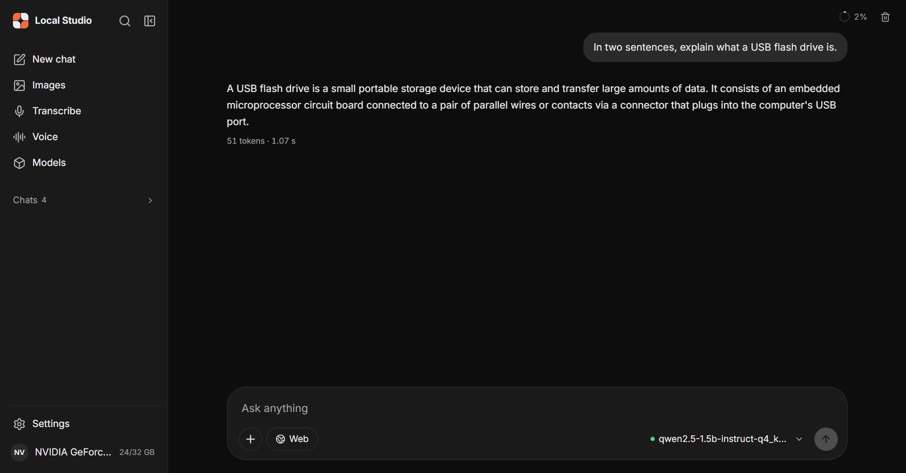 |

A small task with the 0.5B model, "Extract exactly three fields: name, date, amount", gave `Alice, 2026-10-31, $37.50` in 419 ms:

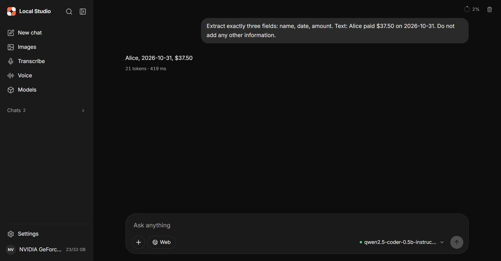

**Before you change to a different chat model, click Unload.** If you select a second model while the first one is loaded, the load fails and the app can fall back to KV q4_0.

---

## 7. Examples: images, speech, voice and a voice loop

### 7.1 Make a product image (DreamShaper 8)

1. Click **Models**. Click the **Image** tab.
2. In the **SD 1.5** group, find **DreamShaper 8**. Click its download button.
3. In the dialog "Download "DreamShaper 8" (~2.1 GB)?", click **Download**. On our laptop, it took about 40 s.
4. In the sidebar, click **Images**. Click **Select model** at the bottom-right corner. Click **DreamShaper_8_pruned**.
5. If the app asks "Unload the chat model?", click **Unload and load**.
6. Wait until the top bar shows a green dot, **Image** and **DreamShaper_8_pruned**. The bar under the prompt must show 512×512 and 20 steps.
7. Click **More**. Make sure that CFG scale is 7. Type this in **Negative prompt**: `blurry, low quality, text, watermark, deformed`
8. Press **Esc** to close **More**. Type this prompt: `product illustration of a matte black reusable water bottle on a light wooden table, soft studio lighting, clean background, high detail`
9. Press **Enter**, or click the arrow button.

The image took 34.3 s: 27.2 s for the 20 steps (about 1 s per step after a 7.9 s first step) and 4.6 s to decode. The app saves each image as a PNG file and a JSON file in `app\outputs`.

| Download dialog | Result: 512×512, 20 steps, seed 771147, 34.3 s |
|---|---|
| 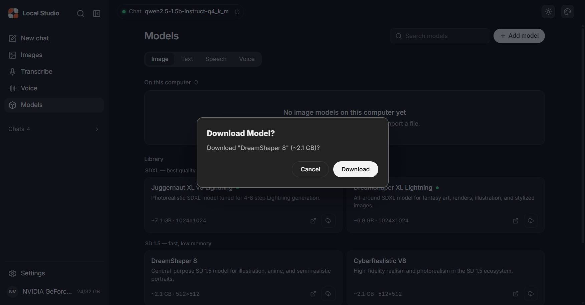 | 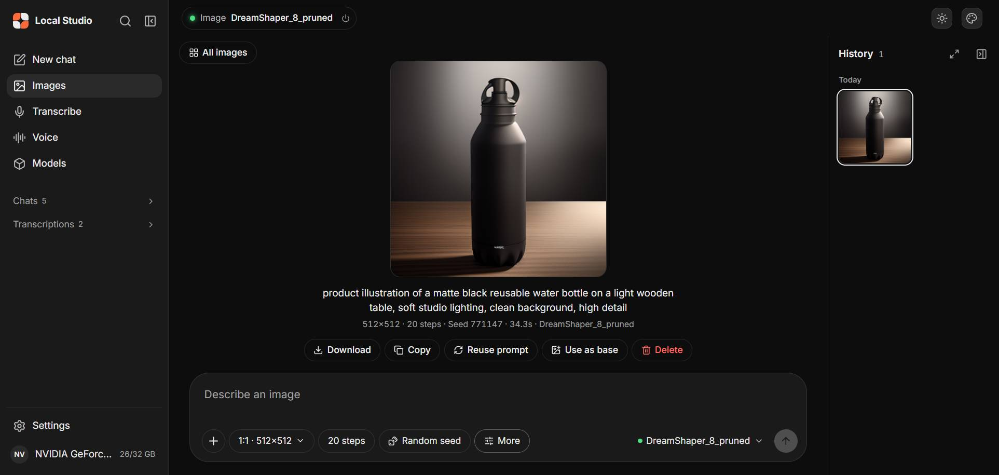 |

**Output file:** [`samples/images/output-2026-11-01T15-27-05-777Z-771147.png`](samples/images/output-2026-11-01T15-27-05-777Z-771147.png) (381,033 bytes) with its settings in the [JSON file](samples/images/output-2026-11-01T15-27-05-777Z-771147.json).

> [!CAUTION]
> On our 4 GB laptop, the library put the "Fits your PC" mark on the two SDXL models (6.9 GB and 7.1 GB), not on the SD 1.5 models. We did not test SDXL. On a 4 GB GPU, start with SD 1.5.

### 7.2 Make a blog header (wide image)

1. In **Images**, click the size button. Select **16:9 · 768×432**.
2. Type the prompt: `wide blog header, cozy home office desk with a laptop and a cup of coffee at sunrise, warm light, plants, shallow depth of field, digital painting`
3. Click the arrow button.

Result: 768×432, 20 steps, 29.0 s. File: [`samples/images/output-2026-11-01T15-28-04-538Z-552823.png`](samples/images/output-2026-11-01T15-28-04-538Z-552823.png) (709,066 bytes).

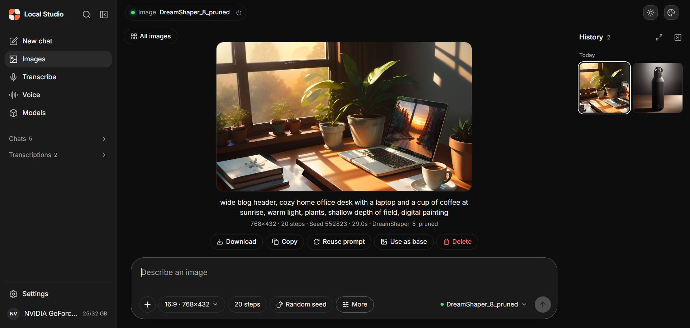

### 7.3 Turn text into speech (Kokoro) and speech into text (Whisper)

**Install the voice model:**

1. Click **Models**. Click the **Voice** tab.
2. Find **Kokoro 82M ONNX Q8**. Click **Download**.
3. The dialog says "Kokoro model files are cached on first generation." Click **Install**. In our test, the install already downloaded the 92 MB model.

**Make a voice clip:**

1. In the sidebar, click **Voice**.
2. Select the voice **Heart**.
3. Type: `Voice memo for Monday. Call the print shop about the two hundred flyers, they are due on Thursday. Ask Dana for the budget sheet before noon. The team meeting moves to three p.m. on Wednesday.`
4. Click **Speak**.

Result: a 14.4 s clip (690,524 bytes), ready about 14 s after the click. Voices: Heart, Bella, Nicole, Sarah, Michael, Fenrir (US English); Emma, George (UK English).

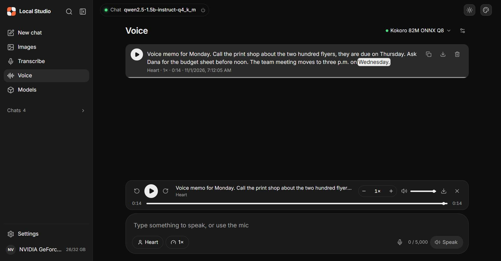

**Listen:** [`samples/voice/tts-2026-11-01T15-12-05-082Z-af_heart.wav`](samples/voice/tts-2026-11-01T15-12-05-082Z-af_heart.wav)

**Install the speech-to-text model:**

1. Click **Models**. Click the **Speech** tab.
2. Find **Whisper Base English** (the app shows "142 MB"; the file is 147,964,211 bytes). Click **Download**. In the dialog, click **Download**.
3. If the Speech tab shows the Kokoro list, click another tab and then **Speech** again. This is a display error in the app.

**Transcribe the clip:**

1. In the sidebar, click **Transcribe**. Make sure that the top-right menu shows **Whisper Base English**.
2. Click **Upload audio**. Select the WAV file from `app\tts-outputs` on the drive. The app accepts WAV, MP3, M4A, OGG, FLAC and WebM.
3. Click **Transcribe** beside the file.
4. Wait for the text under **Transcript**. Read it and correct it.

Result: the 14.4 s memo took 9.2 s. Text: "Voice memo for Monday. Call the print shop about the 200 flyers they are due on Thursday. Ask Dana for the budget sheet before noon. The team meeting moves to 3P. M. on Wednesday."

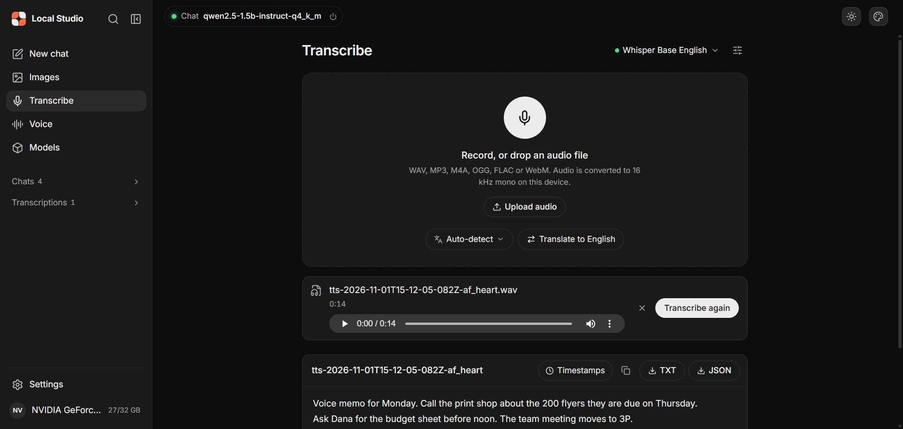

**Output file:** [`samples/transcripts/…af_heart.wav.txt`](samples/transcripts/transcript-2026-11-01T15-21-58-654Z-tts-2026-11-01T15-12-05-082Z-af_heart.wav.txt)

**Whisper Base English** understands English only. For other languages, download a multilingual Whisper model (not tested).

### 7.4 A "Jarvis" voice loop: all three together

The app has no automatic voice mode. You move the text between the tabs with copy and paste. All four steps worked with the 1.5B chat model loaded.

1. **Voice:** select **George**. Type `What are three simple ways to make a laptop battery last longer? Answer in two short sentences.` Click **Speak**. Result: an 8.0 s clip. [Listen](samples/voice/tts-2026-11-01T15-18-03-287Z-bm_george.wav).
2. **Transcribe:** upload that clip. Result: the exact question in 2.0 s. [Transcript](samples/transcripts/transcript-2026-11-01T15-22-31-601Z-tts-2026-11-01T15-18-03-287Z-bm_george.wav.txt).
3. **Chat:** paste the question. Result: 28 tokens in 913 ms. The small model gave 2 tips, not 3.
4. **Voice:** paste the answer. Select **Heart**. Click **Speak**. Result: a 409,004-byte clip in about 20 s. [Listen](samples/voice/tts-2026-11-01T15-23-42-997Z-af_heart.wav).

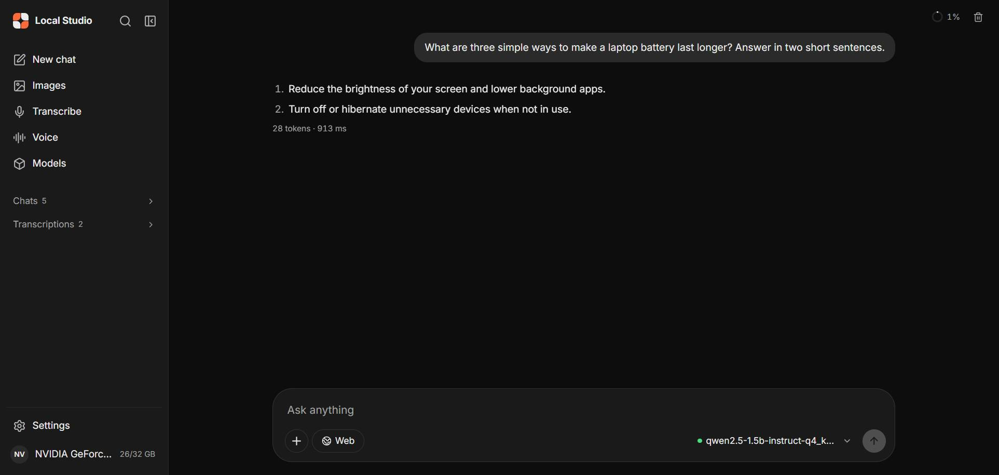

### 7.5 Meeting notes to a to-do list

1. Copy the memo transcript from **Transcribe**.
2. In **Chat**, type `Turn this voice memo transcript into a to-do list with one line per task and its deadline. Transcript:` and paste the transcript.
3. Press **Enter**.

Result: 3 tasks, 38 tokens in 999 ms. **Check the result:** the model added "by 4PM", which the memo does not contain. Small models can add facts.

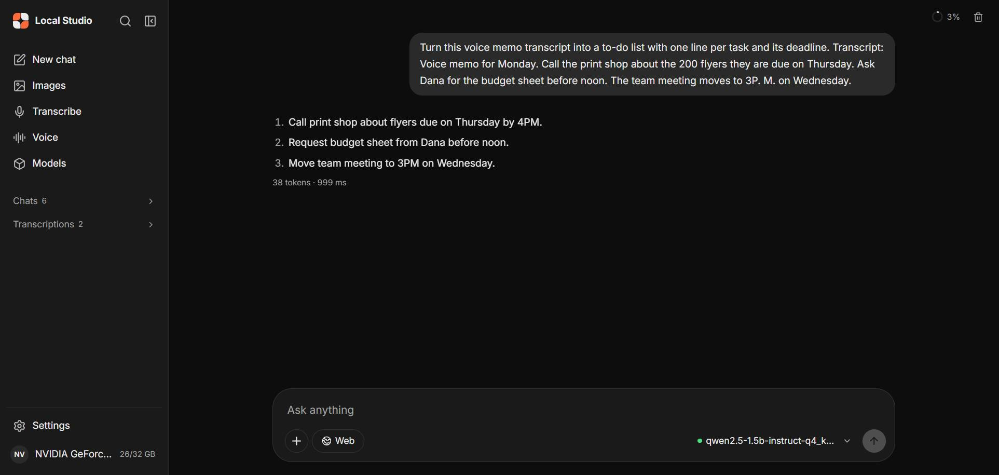

### 7.6 Make a short video (new Video tab)

The upstream app has no video feature. Its image engine (stable-diffusion.cpp, release `master-782-b290693`) can make video with `--mode vid_gen` and an AnimateDiff motion module. We added a **Video** page and a **Models → Video** tab that use it. The code is in [`studio/`](studio/): two new files (`scripts/server/video.cjs`, `app/frontend/src/components/VideoGenerator.jsx`) and 27 changed lines in 5 upstream files. Windows only.

**Get the version with the Video tab:**

1. Open <https://github.com/az9713/local-studio-usb-ai-demo>. Click **Code**, then **Download ZIP**.
2. Extract the ZIP. Copy the `studio` folder to the USB drive.
3. Run the setup in that folder as in [section 5.3](#53-run-the-first-time-setup).

If you already have the upstream app on the drive, copy these files from `studio\` over it and keep your `app` folder: `scripts\server\serve.cjs`, `scripts\server\video.cjs`, `scripts\server\origin-check.cjs`, `app\frontend\src\App.jsx`, `app\frontend\src\components\Sidebar.jsx`, `app\frontend\src\components\ModelManager.jsx`, `app\frontend\src\components\VideoGenerator.jsx`. Then delete `app\dist` and start `windows.bat`. Without `app\dist`, `windows.bat` runs setup again, and setup rebuilds the interface (`windows.bat` line 36, `setup.ps1` line 694; FROM CODE). In our test, we rebuilt `app\dist` with `vite build` ourselves, so this route is NOT TESTED.

**Install the motion module:**

1. Click **Models**. Click the **Video** tab.
2. On **AnimateDiff v3 motion module (SD 1.5)**, click **Download** (837 MB). In our test, it took about 11 s.
3. Make sure that an SD 1.5 image model is on the drive, for example DreamShaper 8 ([section 7.1](#71-make-a-product-image-dreamshaper-8)).

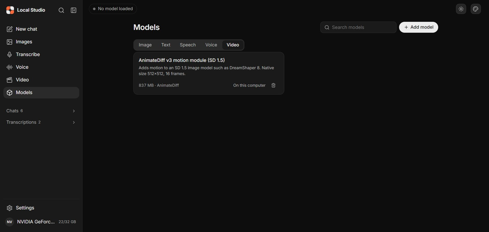

**Make a clip:**

> [!CAUTION]
> Video uses the GPU much more than one image. Close other programs that use the GPU (games, video players, other AI apps) before you start. In our test, other programs held about 2.3 GB of the 4 GB VRAM, and a 256×256 clip took 560.2 s. A 384×384 clip took 152.6 s when the GPU was free.

1. In the sidebar, click **Video**.
2. Type a prompt with motion, for example `ocean waves crashing on rocks at sunset, storm clouds, wind, sea spray, cinematic, high detail`.
3. Select the size (256×256, 384×384 or 512×512) and the frames (8 or 16).
4. Click **Make video**.
5. If the app asks "Unload the chat model?", click **Unload and make video**.
6. Wait. The page shows the step and the time. Click **Stop** to cancel.

| The unload dialog | Result: 256×256, 8 frames, seed 42 |
|---|---|
| 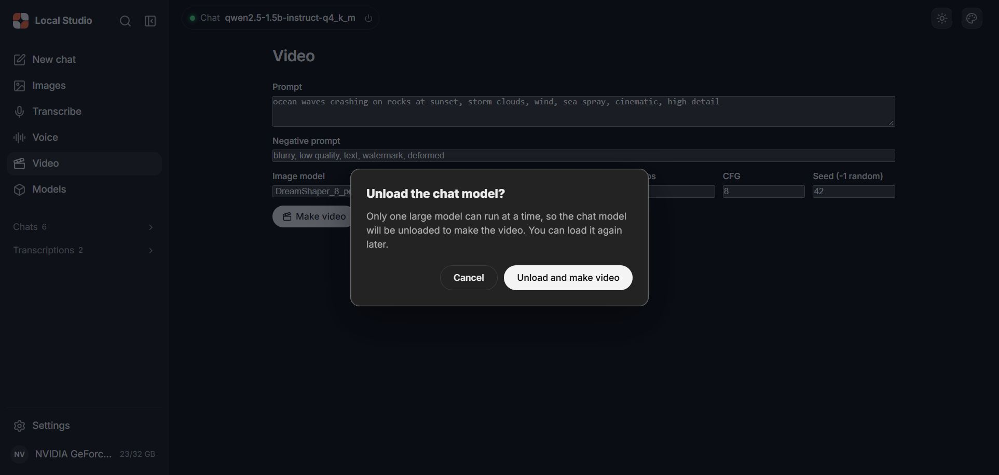 | 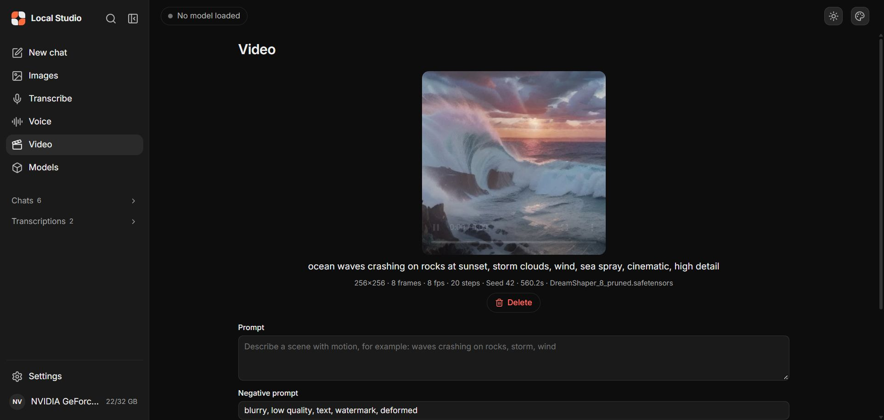 |

**Measured on the RTX 3050 4 GB laptop:**

| Run | Size, frames, steps | Time | File |
|---|---|---|---|
| Command line, GPU free | 384×384, 8, 20 | 152.6 s (sampling 145.1 s, decode 6.8 s) | [cli-384x384-8f-seed42.webm](samples/video/cli-384x384-8f-seed42.webm), 201,768 bytes |
| Video tab, browser and other apps on the GPU | 256×256, 8, 20 | 560.2 s | [video-…-42.webm](samples/video/video-2026-11-01T22-06-44-642Z-42.webm), 124,178 bytes |
| Command line, 512×512, no VRAM cap | 512×512, 8, 20 | stopped: step 4 took 103.5 s | — |
| Video tab, 384×384, browser and other apps on the GPU | 384×384, 8, 20 | stopped: still at step 1 after 256 s | — |

After the 512×512 run, the app always passes `--max-vram 2.0 --stream-layers` to the engine. The clips are 1 s long (8 frames at 8 fps), in WebM format. The app saves them to `app\video-outputs` with a JSON file of the settings. AnimateDiff makes short, low-resolution motion, not long videos.

**Fit on a 128 GB drive:** the motion module is 836,618,008 bytes, and it reuses the image model that is already on the drive. A 1 s clip is 124,178–201,768 bytes. The engine also supports larger video models (for example Wan 2.1/2.2 and LTX-Video). They need several GB more on the drive and more than 4 GB of VRAM. We did not test them.

---

## 8. Keep every file on the drive

We recorded the time before the image, speech and voice tests. After the tests, we listed every file larger than 100 KB that changed on drive C: in the cache, temp, NVIDIA and Downloads folders.

**Result:** no studio model, cache or output was outside the drive. The only writes were the test browser's own profile and the NVIDIA shader cache. Details: [`evidence/storage-measurement.txt`](evidence/storage-measurement.txt).

Follow these rules:

1. Run the first setup with `set npm_config_cache=%CD%\app\tools\npm-cache` ([step 5.3](#53-run-the-first-time-setup)). Otherwise, setup writes its download cache to `%LOCALAPPDATA%\npm-cache` on drive C:.
2. Use the files that the app already saved on the drive: images in `app\outputs`, voice clips in `app\tts-outputs`, transcripts in `app\transcriptions`, chats in `app\chat-history`.
3. Do not click the browser buttons **Download**, **TXT**, **JSON** or **Download WAV** if you want no copy on the PC. They save a copy to your `Downloads` folder on drive C:.
4. Keep the audio files that you transcribe on the drive.
5. Download models only through the app. The app saves them in the `app` folder on the drive.

The Microsoft Visual C++ runtime (if setup installs it) and the GPU driver caches are parts of Windows, not of the studio.

---

## 9. Use it offline

We did not run the full offline test: we could not switch off the network without administrator rights. The manual's [Step 17](https://az9713.github.io/local-studio-usb-ai-demo/local-studio-windows-setup.html#offline) gives the test. Do it before you depend on the app offline.

1. While you are online, download every model that you need: chat, image, Whisper and Kokoro.
2. Stop the app with **Ctrl+C**.
3. Disconnect Wi-Fi, Ethernet and phone tethering.
4. Double-click `windows.bat`. Offline, the update check shows `[WARN] Could not update the llama.cpp backend (offline?)` and continues.
5. Make one new chat answer, one image, one transcript and one voice clip.

---

## 10. Stop the app and remove the drive

1. Click into the black terminal window of `windows.bat`.
2. Press **Ctrl+C**. If Windows asks "Terminate batch job (Y/N)?", type `Y` and press **Enter**.
3. Wait until the window closes.
4. Use **Safely Remove Hardware** to eject the drive. The app reads models from the drive while it runs.

---

## 11. Problems and fixes

| Problem | Cause | Fix |
|---|---|---|
| Chat answers are nonsense | KV cache Q4_0 | Unload. Set KV cache to Q8_0. Load again. |
| "… is already loaded as a Text model. Unload it before loading …" | A second model was selected while the first one was loaded | Unload the first model, then select the second one. |
| Setup stops at [5/8] Kokoro with `npm ERR! code ENOENT` | A damaged entry in the PC's shared npm cache | Run setup again with `set npm_config_cache=%CD%\app\tools\npm-cache`. |
| The browser opens the wrong page, or no page | Port 1420 was in use | Use the **Web UI:** address in the terminal. |
| Another local tool stops when the studio starts | `windows.bat` force-closes programs on ports 8080 and 10086 | Stop the other tool first. |
| The Speech tab in Models shows the Kokoro list | Display error in the app | Click another tab, then **Speech** again. |
| The voice says "three p." and "m. on Wednesday" with a pause | The sentence splitter cuts "p.m." | Write "3 PM" or "three in the afternoon". |

More fixes: manual [section 19](https://az9713.github.io/local-studio-usb-ai-demo/local-studio-windows-setup.html#gotchas).

---

## 12. What we did not test

- Real USB speed and exFAT. The files came from the internal SSD through `subst`.
- The full offline test.
- AMD, Intel Arc and CPU-only PCs as the main hardware.
- The microphone (**Start recording**, **Dictate**). We used audio files from the Voice workspace.
- Other languages and **Translate to English**.
- SDXL models, **Use as base** (image to image), file attachments and web search.
- Image model and Whisper or Kokoro at the same time.
- The Video tab on Linux and macOS, with AMD or Intel GPUs, with 16 frames, and at 512×512. Wan and LTX-Video models.
- macOS and Linux.

---

## 13. Files in this repo

| Path | Contents |
|---|---|
| [`local-studio-windows-setup.html`](https://az9713.github.io/local-studio-usb-ai-demo/local-studio-windows-setup.html) | The full manual (23 sections, 15 screenshots built in). Live page on GitHub Pages. |
| [`screenshots/`](screenshots/) | 18 screenshots as JPEG files (3 of them for Video). |
| [`samples/images/`](samples/images/) | 2 PNG images and their settings (JSON). |
| [`samples/voice/`](samples/voice/) | 3 WAV clips and their settings (JSON). |
| [`samples/video/`](samples/video/) | 2 WebM clips (1 s each) and the settings (JSON) of the Video-tab clip. |
| [`studio/`](studio/) | Independent copy of the app (upstream MIT) with the Video feature. Commit `d7d2d2e` is the unchanged upstream copy. The next commit adds Video. |
| [`samples/transcripts/`](samples/transcripts/) | 2 transcripts (TXT) and the full Whisper output (JSON). |
| [`evidence/storage-measurement.txt`](evidence/storage-measurement.txt) | Disk measurement, per folder and per model, and the check for files outside the drive. |
| `index.html` | Sends the Pages home address to the manual. |

This repo has no license file of its own. The app in `studio/` belongs to its creator under the MIT License: see [`studio/LICENSE`](studio/LICENSE) and [techjarves/Portable-Local-Studio](https://github.com/techjarves/Portable-Local-Studio). The Video additions are not part of upstream, and we sent no pull request.
